  

---

  

## 📈 CONTRIBUTION ANALYTICS

## 🐍 CONTRIBUTION ACTIVITY

<picture>
  <source media="(prefers-color-scheme: dark)" srcset="https://raw.githubusercontent.com/farhanshn/farhanshn/output/github-snake-dark.svg?v=3">
  <source media="(prefers-color-scheme: light)" srcset="https://raw.githubusercontent.com/farhanshn/farhanshn/output/github-snake.svg?v=3">
  
</picture>

---

## 📊 GITHUB ACTIVITY

<img
