  

---

  

---

  PROJECTS + CERTIFICATIONS
  Edit the text inside featured_projects.svg and certifications.svg
  (they are plain text), then delete the "<!--" line and the "-->" line
  around the block below to show them.

  

---

## 📈 CONTRIBUTION ANALYTICS

## 🐍 CONTRIBUTION ACTIVITY

---

## 📊 GITHUB ACTIVITY

---

## 📫 LET'S CONNECT

I'm always open to collaborating on Machine Learning and AI projects, exploring new technologies, and connecting with fellow developers.

&nbsp;

&nbsp;

&nbsp;

  

**"Turning data into intelligence, and ideas into reality."**

